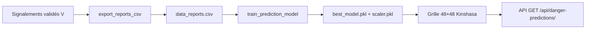

# Modèle de prédiction de danger — SSU Bokengi

Ce document décrit **où** le modèle est entraîné, **comment** il est utilisé en production, et **pourquoi** nous utilisons un **Gradient Boosting** plutôt que d'autres algorithmes.

## Pipeline en bref



## Où le modèle est entraîné

| Étape | Fichier / commande | Rôle |
|--------|-------------------|------|
| Export BDD → CSV | `prediction/tasks.py` → `export_reports_to_csv` | Tâche Celery horaire ; aussi `python manage.py export_reports_csv` |
| Entraînement Django | `prediction/training.py` → `train_gradient_boosting_classifier` | Algorithme canonique, écrit `prediction/model/best_model.pkl` et `scaler.pkl` |
| Commande manuelle | `python manage.py train_prediction_model` | Réentraîne après export |
| Tâche planifiée | Celery `prediction.tasks.train_prediction_model` | Export + entraînement local + microservice si activé |
| Microservice | `ai_services/prediction_service/app/engine.py` → `train_model()` | Même logique GBC sur le volume partagé `prediction_models` |
| Inférence carte | `prediction/views.py` → `_load_prediction_assets()` | Charge CSV + modèle pour la heatmap et les itinéraires |

**Planification** : dans `ssu_backend/settings.py`, la tâche `train_prediction_model_hourly` appelle `prediction.tasks.train_prediction_model`.

## Features (6 variables)

Pour chaque point (signalement ou cellule de grille) :

1. `latitude`, `longitude`
2. `hour`, `day_of_week` (depuis `created_at` à l'entraînement, heure courante à l'inférence)
3. `density` — nombre de signalements dans un rayon de **500 m** (BallTree, distance haversine)
4. `mean_degree_danger` — degré moyen des voisins (0=faible, 1=modéré, 2=élevé)

Ces features capturent la **géographie**, le **contexte temporel** et la **concentration locale** d'incidents — adapté à une ville avec peu de données structurées.

## Pourquoi Gradient Boosting (et pas SVM / Random Forest seul)

| Critère | Gradient Boosting | Random Forest | SVM |
|---------|-------------------|---------------|-----|
| Peu de données (&lt; 1000 lignes) | Bon avec régularisation (`max_depth=4`) | Correct mais moins précis sur petits jeux | Sensible au choix du noyau ; risque de sous-apprentissage |
| Features tabulaires mixtes (lat, densité, heure) | Excellent pour interactions non linéaires | Bon baseline | Nécessite scaling soigneux |
| Déséquilibre F/M/E | `sample_weight` par classe | Possible | Difficile |
| Interprétabilité / déploiement | `joblib`, rapide à l'inférence | Idem | Plus lourd |
| Données bruitées (scraping, synthétique) | Arbres successifs lissent le bruit | Variance plus élevée | Outliers pénalisants |

**Conclusion** : avec 50–500 signalements Kinshasa, des labels hétérogènes et des features géospatiales dérivées, **GradientBoostingClassifier** (100 arbres, `learning_rate=0.1`) offre le meilleur compromis précision / robustesse / simplicité de déploiement pour SSU Bokengi.

Les anciens commentaires « SVM » dans le code sont obsolètes ; l'implémentation active est le **Gradient Boosting**.

## Données d'entraînement

- **Réels** : signalements `status=V` avec coordonnées valides (citoyens, utilisateurs, articles validés manuellement).
- **Synthétiques** (optionnel) : `python manage.py seed_synthetic_reports --count 20` — marqués `external_source_url=synthetic://training/...`, répartis par commune, degrés F/M/E pondérés.
- **Nettoyage** : `python manage.py clean_validated_reports` rejette blagues, actualités hors sécurité, GPS sur le fleuve ou incohérents avec le lieu.

Les scrapés (`source=S`) ne sont **plus validés automatiquement** par l'IA (`reports/ai_settings.py`) tant que la fusion n'est pas fiable.

## Validation géographique à la création

`locations/geo_validation.py` :

- Hors polygone Kinshasa (OSM)
- **Fleuve Congo / Pool Malebo** — coordonnées rejetées
- **Coordonnées mensongères** — si le texte cite une commune/quartier, distance max 12 km / 6 km au centroïde attendu

## Commandes utiles (Docker)

```bash
docker compose exec web python manage.py clean_validated_reports --dry-run
docker compose exec web python manage.py clean_validated_reports
docker compose exec web python manage.py seed_synthetic_reports --count 20 --clear
docker compose exec web python manage.py export_reports_csv
docker compose exec web python manage.py train_prediction_model
```

Ou en une fois via Celery : tâche `train_prediction_model` (export + entraînement).

## Fichiers modèle

| Fichier | Description |
|---------|-------------|
| `prediction/data/data_reports.csv` | Dataset exporté |
| `prediction/model/best_model.pkl` | Classifieur GBC entraîné |
| `prediction/model/scaler.pkl` | StandardScaler des 6 features |

Ces fichiers sont générés au runtime ; ne pas committer des modèles obsolètes entraînés sur 14 signalements tous « élevé ».
